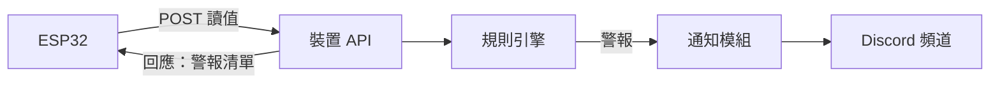

# fis-server

孔雀魚魚缸的監測後端。它接收感測器讀值，用規則判斷異常，再發出處置建議。

## 目前狀態

本專案在早期開發階段。目前只有一條假流程，用來驗證各模組能接起來。

- 規則寫死在程式裡，只有 3 條。門檻是暫定值。
- 還沒有資料庫。讀值不會儲存。
- 裝置 API 還不驗證裝置身分。
- API 和資料格式未定，之後可能變更。

## 設計原則

- 本地管安全，雲端管建議。溫控只在 ESP32 內完成，所以斷網時魚缸仍然安全。
- 警報只由規則引擎判斷。規則引擎不呼叫 LLM,相同輸入一定得到相同結果。
- LLM 只負責說明警報、解析使用者回報、回答追問(尚未實作)。
- LLM 可以呼叫的工具全部唯讀。沒有任何工具可以控制硬體。
- 資料不可信時，相關建議降級為「請確認」。原始資料不刪改。

## 目前的流程



1. ESP32 把讀值送到裝置 API。
2. 裝置 API 把讀值交給規則引擎。
3. 規則引擎判斷讀值。如果有異常，產生警報。
4. 通知模組把每個警報送到 Discord 頻道。
5. 裝置 API 回傳警報清單給 ESP32。

## 目錄結構

```
fis-server/
├─ backend-api/            後端(Python、FastAPI)
│  ├─ app/
│  │  ├─ main.py           程式進入點
│  │  ├─ config.py         讀取 .env 設定
│  │  ├─ device_api/       裝置 API:接收 ESP32 讀值(假版本)
│  │  ├─ rules_engine/     規則引擎：判斷讀值是否異常(假版本)
│  │  └─ notifier/         通知模組：送 Discord 通知
│  ├─ tests/               自動測試
│  └─ TESTING.md           執行與測試步驟
└─ web-page/               網頁(尚未建立)
```

以下模組已規劃，但尚未建立:應用 API、資料品質檢查、排程器、LLM 說明功能。

## API(格式未定)

| 方法 | 路徑 | 用途 |
|---|---|---|
| `GET` | `/health` | 確認伺服器正在執行 |
| `POST` | `/api/v1/device/readings` | 上傳一筆讀值 |

上傳讀值的請求內容:

```json
{"device_id": "tank-01", "temperature_c": 30.5, "ph": 7.2}
```

| 欄位 | 必填 | 說明 |
|---|---|---|
| `device_id` | 是 | 裝置代號 |
| `temperature_c` | 是 | 水溫，單位 °C |
| `ph` | 否 | pH 值 |
| `tds_ppm` | 否 | TDS,單位 ppm。目前收下但不判斷 |

回應內容:

```json
{
  "alerts": [{"rule_id": "FAKE-TEMP-HIGH", "severity": "critical", "title": "水溫過高"}],
  "notify_errors": []
}
```

- `alerts`:規則引擎產生的警報。沒有異常時是空清單。
- `notify_errors`:送 Discord 失敗的訊息。送失敗時，讀值上傳仍然成功。

## 相關文件

- 執行與測試步驟:[backend-api/TESTING.md](backend-api/TESTING.md)
